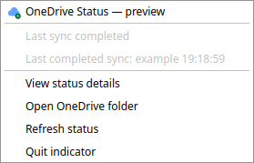

# OneDrive Status

An independent, read-only Qt 6 tray companion for [abraunegg/onedrive](https://github.com/abraunegg/onedrive) running as a systemd user service. Preview v0.1.0.



*Example menu with demonstration data.*

## What it shows

- Green: the client reported a completed sync.
- Blue: syncing.
- Amber: connecting or stale status (no journal activity for 12 minutes).
- Red: a detected error or a confirmed stopped/failed service.

Click the cloud for details and the last completed sync time. Right-click to open `~/OneDrive`, refresh, or quit. Refreshes every 15 seconds. An unavailable service check does not override successful sync logs.

## Install

Requires Python 3.10+, PyQt6, systemd, a readable user journal, and a desktop system tray. On Debian/Ubuntu install `python3-pyqt6` using your package manager.

Download and extract the release archive, then run from the extracted folder:

```sh
python3 install.py
```

Open **OneDrive Status** from the application menu. Installation is for the current user; no administrator rights are required. It starts at login. Use `python3 install.py --no-autostart` for a new installation without automatic startup.

Files use `XDG_DATA_HOME` and `XDG_CONFIG_HOME`, defaulting to `~/.local/share` and `~/.config`. To uninstall, quit the indicator and remove the `onedrive-status` application directory and `onedrive-status.desktop` entries from `applications` and `autostart`.

## Scope and limitations

This app reads the last 24 hours (up to 1,000 messages) of `onedrive.service` in the **user** journal. It never starts/stops syncing or edits client configuration. It supports one default user service and opens the default `~/OneDrive` folder. Custom service names, folders, system services, and Docker healthchecks are not supported in this preview.

Status comes from English log messages, not a supported machine-readable status API. Message changes or unrecognized errors may affect detection. Green means a reported completed cycle; it does not independently verify each file or guarantee there are no skipped files. The 12-minute stale threshold may be unsuitable for longer monitor intervals or quiet event-driven setups.

Used locally with KDE Plasma 6.6.6 on Wayland and OneDrive client 2.5.11. Other desktops and client versions need testing. This is a community companion, not an official Microsoft or OneDrive project release.

## Development

```sh
/usr/bin/python3 -m unittest -v test_status
```

Contributions and bug reports are welcome. Please omit personal filenames, account information, and credentials from reports.

## License

GPL-3.0-or-later; see LICENSE. Copyright 2026 mcgates. PyQt6 is a separately licensed dependency.
